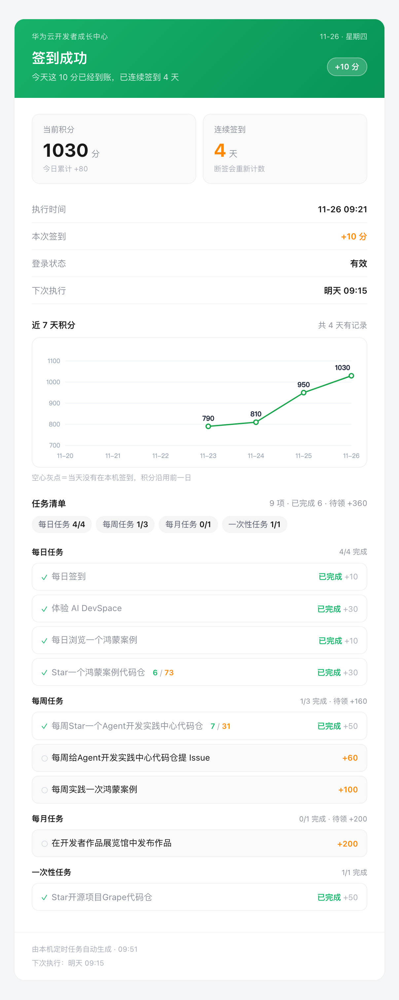

# hw-grow-check

**华为云开发者成长中心 · 自动签到与每日任务自动化**

*Huawei Cloud Developer Growth Center — auto check-in & daily task automation, built with Node.js and Playwright.*

覆盖新版成长中心（[grow.developer.huaweicloud.com](https://grow.developer.huaweicloud.com/)）的签到、AI DevSpace 体验、鸿蒙案例浏览和 GitCode Star，每日任务满分 80 分，不用手动点页面。纯 Node.js + Playwright 实现，可交给智能体、cron 或任意调度器定时运行。

- 配好 GitCode 令牌后，**每日 4 个任务全部自动**；每周 Star 任务也能自动，按周去重
- 签到走接口，不是模拟点击，几秒完成
- 每次运行发一封结果邮件（积分曲线 + 完整任务清单），也可推送到飞书、钉钉、企业微信、Bark、Server酱
- 仓库池空了会停止请求并提醒，不会重复 Star，也从不取消 Star

> **免责声明**
>
> 本项目是个人自动化实践，**与华为云官方无关**，未获得任何官方授权或背书。
> 使用自动化工具可能违反平台服务条款，存在账号被限制或封禁的风险，请自行评估并承担后果。
> 本项目只面向**单账号的日常签到**，不要用于多账号刷分——页面公告已明确「请勿多账号刷分，一经发现封禁处理」。
> 接口与页面结构可能随时变化，项目不保证长期可用。

## 自动完成哪些任务

| 周期 | 任务 | 分值 | 自动化 |
|---|---|---|---|
| 每日 | 签到 | +10 | ✅ 接口完成 |
| 每日 | 体验 AI DevSpace | +30 | ✅ 打开实践中心点入口，等埋点上报 |
| 每日 | 浏览一个鸿蒙案例 | +10 | ✅ 打开案例页停留 40 秒 |
| 每日 | Star 一个鸿蒙案例代码仓 | +30 | ✅ 需 GitCode 令牌 |
| 每周 | Star 一个 Agent 开发实践中心代码仓 | +50 | ✅ 同一个令牌，按周去重 |
| 每周 | 给 Agent 开发实践中心代码仓提 Issue | +60 | ❌ 需要真实的反馈内容 |
| 每周 | 实践一次鸿蒙案例 | +100 | ❌ 需在作业中心真实创建并编译 |
| 每月 | 在开发者作品展览馆中发布作品 | +200 | ❌ 需要真实产出 |
| 一次性 | Star 开源项目 Grape 代码仓 | +50 | ❌ 需 GitHub 账号 |

Star 类任务只做「加 Star」，从不取消；仓库池空了会停止请求，并在邮件里提醒。

## 效果

每次运行结束会收到这样一封结果邮件，签到结果、积分变化、近 7 天曲线和完整任务清单都在里面，Star 那两行还会显示当前进度（图中 6/73、7/31）：

<p align="center">
  
</p>

失败、告警和补签提醒的样子见 [`docs/mail-preview/`](docs/mail-preview/)。

## 和 hwcloud-grow 的区别

社区里的 `hwcloud-grow` 系列脚本针对的是**旧版**成长中心（旧站的任务体系），旧站任务已下线，脚本跑通也拿不到分。

本项目走新版 `grow-dataset.developer.huaweicloud.com` 接口，对齐当前实际存在的任务：签到、AI DevSpace、鸿蒙案例浏览、GitCode Star。如果你是从旧项目找过来的，直接换这个即可。

## 快速开始

需要 Node.js >= 18，以及 Playwright 版 Chromium 或本机已安装的 Chrome。

### 1. 安装

```bash
git clone <你的仓库地址> hw-grow-check
cd hw-grow-check
npm install
npx playwright install chromium
```

### 2. 配置账号

邮件、GitCode、华为云账号的凭据统一写在 `data/account.json`，只写用到的段。**只跑签到可以跳过这一步**；要用结果邮件或 Star 任务，再补对应段。

```json
{
  "mail":     { "host": "smtp.qq.com", "port": 465, "user": "you@example.com", "pass": "授权码", "to": "you@example.com" },
  "gitcode":  { "token": "xxxxxxxx", "username": "your-gitcode-name" },
  "huawei":   { "account": "手机号或邮箱", "password": "登录密码" }
}
```

```bash
chmod 600 data/account.json
```

- `mail`：结果邮件与失败告警
- `gitcode`：两个 Star 任务
- `huawei`：可选。`run` 发现会话失效时会自动用账号密码登录一次；配好后也可以用 `node src/cli.mjs login --from-env` 完全跳过扫码

环境变量 `GROW_GITCODE_TOKEN`、`GROW_ACCOUNT`、`GROW_PASSWORD` 优先于文件；环境变量默认值见 [`.env.example`](.env.example)。完整字段和配置步骤见 [详细说明 · 账号配置](docs/GUIDE.md#账号配置)。

### 3. 登录

```bash
npm run login      # 弹出浏览器扫码，登录态存到 data/auth.json
npm run status     # 确认能读到积分和任务
```

没有图形界面时用 `node src/cli.mjs login --qr`，二维码会截图到 `data/login-qr.png`。

### 4. 跑一次

```bash
npm run run        # 执行启用的任务（默认五项全开）
npm run status     # 查看积分与全部任务
npm run doctor     # 环境自检
```

只想跑签到：

```bash
GROW_TASKS=checkin node src/cli.mjs run
```

## 定时运行

脚本不带守护进程，交给外部调度器调用 `scripts/daily.sh`。

**智能体 / 自动化平台**（推荐）

```bash
bash scripts/daily.sh
```

**cron**

```bash
15 9 * * 1-5 cd /path/to/hw-grow-check && bash scripts/daily.sh >> data/cron.log 2>&1
```

工作日 `daily.sh` 会打开浏览器等你扫码（最长 10 分钟）；无人值守的场景改用 `bash scripts/daily.sh --weekend`。

## 常见问题

**需要一直开着电脑吗？**
不需要一直开。定时任务触发时机器在线即可；配好 `data/account.json` 的 `huawei` 段后，登录态过期也能自动用账号密码重登。

**会不会导致封号？**
有风险，见上方免责声明。项目只做单账号的日常签到，不涉及多账号刷分；平台条款对自动化并不友好，请自行评估。

**支持多账号吗？**
不支持，也不建议。

## 文档

| 文档 | 内容 |
|---|---|
| [详细说明](docs/GUIDE.md) | 完整配置项、结果邮件、Webhook、GitCode 令牌、全部命令与环境变量、数据与隐私、实现要点、常见问题 |
| [安全说明](SECURITY.md) | 凭据泄露后的处理方式 |
| [邮件预览](docs/mail-preview/) | 成功、失败、告警、补签提醒的实际效果 |

## 贡献

欢迎 Issue 和 PR。提交前请确认：

- 没有把 `data/`、`.env` 或任何真实凭据带进提交
- `node --check` 通过，且至少手动跑过一次 `npm run status`
- 涉及接口变更时，在 PR 里说明是哪个页面 / 接口变了，附上脱敏后的响应结构

## License

[MIT](LICENSE)
